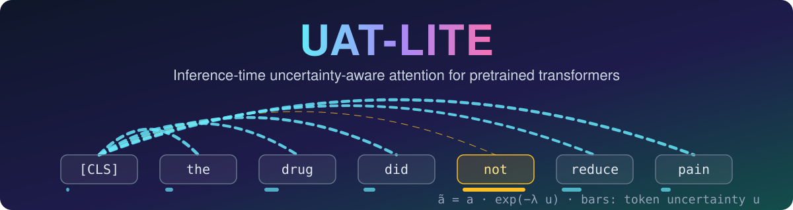
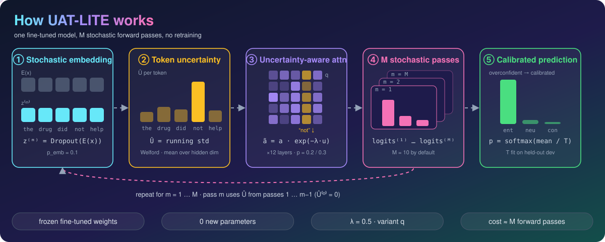

<div align="center">



[](https://arxiv.org/abs/2602.02952)
[](https://github.com/eliashossain001/uat-lite/releases/tag/v1.0)
[](#-installation)
[](https://pytorch.org)
[](https://github.com/huggingface/transformers)
[](#-installation)
[](LICENSE)

**No retraining · No new parameters · Drop-in for any fine-tuned BERT-style classifier**

</div>

## ✨ Overview

UAT-LITE makes a fine-tuned transformer classifier uncertainty-aware **at inference time**.
It runs *M* Monte Carlo dropout passes and, in every pass, attenuates the self-attention
scores with token-level uncertainty estimated online from the stochastic embeddings, so
the model attends less to tokens it is unsure about.

<p align="center"></p>

<details>
<summary><b>📜 Algorithm 1 as pseudocode</b></summary>

```
for m = 1..M:
    z(m)   = embeddings(x) with dropout                      # stochastic embedding
    attention:  a~_ij = a_ij * exp(-λ u_ij),  u_ij from Û(m-1)  # lagged estimate, Û(0) = 0
    logits(m) = classifier(encoder(z(m)))
    Û(m)   = running Std over z(1..m), averaged over the hidden dim   # Welford update
predict with the mean of logits(1..M);  optionally apply temperature scaling (UAT-LITE+TS)
```

</details>

The repository also contains the baselines (temperature scaling, MC dropout, deep
ensembles, SWAG, isotonic regression), the evaluation protocol, and every ablation
and diagnostic from the paper.

## 🧭 Contents

- [Installation](#-installation): pip, conda or Docker
- [Quick start](#-quick-start)
- [Checkpoints](#-checkpoints)
- [Reproducing the paper](#-reproducing-the-paper)
- [Inference options](#-inference-options)
- [Repository structure](#-repository-structure)
- [Citation](#-citation)
- [Lead author & maintainer](#-lead-author--maintainer)

## 📦 Installation

Tested with Python 3.10, PyTorch 2.3.1 (CUDA 12.1), transformers 4.41.2 and datasets 2.19.2.

```bash
git clone https://github.com/eliashossain001/uat-lite.git && cd uat-lite
pip install -e .
```

<details>
<summary><b>🐍 conda</b></summary>

```bash
conda env create -f environment.yml && conda activate uat-lite
```

</details>

<details>
<summary><b>🐳 Docker</b></summary>

No local Python setup needed; requires the NVIDIA Container Toolkit.

```bash
docker build -t uat-lite .
docker run --rm -it --gpus all \
  -v $PWD/experiments:/workspace/uat-lite/experiments \
  -v $PWD/results:/workspace/uat-lite/results \
  -v $HOME/.cache/huggingface:/workspace/hf_cache \
  uat-lite
# inside the container:  make test && make ood
```

</details>

Run `make test` (CPU only, a few seconds) to check the installation.

## 🚀 Quick start

```python
import torch
from transformers import AutoTokenizer
from uat_lite.inference import load_checkpoint

model = load_checkpoint(
    "https://github.com/eliashossain001/uat-lite/releases/download/v1.0/mnli.pt", "cuda")  # or a local path
tok = AutoTokenizer.from_pretrained(model.base_model_name)
batch = tok(["A man is playing a guitar."], ["Someone makes music."], return_tensors="pt").to("cuda")

out = model.forward_uat(batch["input_ids"], batch["attention_mask"], num_samples=10)  # UAT-LITE
probs = torch.softmax(out["logits_samples"].mean(0), dim=-1)    # predictive distribution
token_unc = out["token_uncertainty"]                            # U(x_j) per token, [B, S]
```

<details>
<summary><b>➕ More outputs</b></summary>

`model(input_ids, attention_mask, method="attention")` additionally returns confidence,
abstention decisions, epistemic/aleatoric scores and (with `return_layer_decomposition=True`)
the layer-wise uncertainty attribution.

</details>

## 💾 Checkpoints

The fine-tuned checkpoints are on the
[v1.0 release page](https://github.com/eliashossain001/uat-lite/releases/tag/v1.0)
(weights and config only, ~0.44 GB each):

| File | Task | Base model |
|---|---|---|
| `sst2.pt` | SST-2 (also used for IMDb) | bert-base-uncased |
| `mnli.pt` | MNLI (also used for HANS, ANLI, SNLI) | bert-base-uncased |
| `squad.pt` | SQuAD 2.0 | bert-base-uncased |
| `medqa.pt` | MedQA | Bio_ClinicalBERT |
| `pubmedqa.pt` | PubMedQA | Bio_ClinicalBERT |

<details>
<summary><b>⬇️ Use a checkpoint by URL, or download all of them</b></summary>

Pass a release URL to any script; the file is downloaded once and cached:

```bash
python scripts/ood/anli.py --ckpt_path https://github.com/eliashossain001/uat-lite/releases/download/v1.0/mnli.pt
```

Or place all of them at the default location that every script and `make` target reads from,
`experiments/<task>/bert-base-uncased/checkpoints/best_model.pt`:

```bash
for t in sst2 mnli squad medqa pubmedqa; do
  mkdir -p experiments/$t/bert-base-uncased/checkpoints
  wget -O experiments/$t/bert-base-uncased/checkpoints/best_model.pt \
    https://github.com/eliashossain001/uat-lite/releases/download/v1.0/$t.pt
done
```

</details>

To train them yourself instead, run `make train` and `make train-clinical`.

## 🔬 Reproducing the paper

Every experiment is one `make` target (`make help` lists them) or one script. Shared options:
`--M` (MC samples, default 10), `--uat` (estimator, see below), `--device`, and an output
path. Results are written as JSON under `results/`.

```bash
make train            # BERT-base on SST-2, MNLI, SQuAD 2.0
make train-clinical   # Bio_ClinicalBERT on MedQA, PubMedQA (trains + evaluates)
make eval             # selective prediction, MNLI shift, clinical QA, OOD
make ablations        # Q/K/V, λ, penalty form, negation, behavioral buckets
make latency
```

<details>
<summary><b>🗺️ Paper section → script → make target</b></summary>

| Paper section | Script | Make target |
|---|---|---|
| General NLP calibration (SQuAD 2.0, MNLI, SST-2) | `scripts/evaluate/evaluate.py --checkpoint <ckpt> --dataset <task>` | |
| Distribution shift (MNLI matched → mismatched) | `scripts/evaluate/mnli_shift.py` | `shift` |
| Clinical QA (MedQA, PubMedQA) | `scripts/evaluate/clinical.py` | `train-clinical`, `clinical` |
| Selective prediction | `scripts/evaluate/selective_prediction.py --task {mnli,squad}` | `selective` |
| OOD: HANS, ANLI, SNLI, IMDb | `scripts/ood/{hans,anli,snli,imdb}.py` | `ood` |
| Risk-coverage curves | `scripts/ood/dump_per_example.py`, `scripts/ood/risk_coverage.py` | `risk-coverage` |
| Global MC-dropout diagnostics | `scripts/evaluate/mc_global.py --task <task>` | |
| Computational efficiency and latency | `scripts/efficiency/gpu_latency.py` | `latency` |
| Q/K/V ablation | `scripts/analysis/qkv_ablation.py --task <task>` | `ablations` |
| Sensitivity to λ | `scripts/analysis/lambda_sweep.py` | `ablations` |
| Penalty functional form | `scripts/analysis/penalty_form.py` | `ablations` |
| Negation diagnostics | `scripts/analysis/negation.py`, `scripts/analysis/negation_sanity.py` | `ablations` |
| Behavioral analysis by linguistic bucket | `scripts/analysis/behavioral.py --dataset medqa --ckpt_path <ckpt>` | `ablations` |
| Scale and geometry diagnostics | `scripts/analysis/scale_geometry.py` | |
| Baselines: vanilla, MC dropout, SWAG, ensembles, TS / isotonic | `scripts/train/train_baselines.py`, `train_swag.py`, `train_deep_ensemble.sh`, `scripts/evaluate/evaluate_baselines.py`, `evaluate_deep_ensemble.py`, `calibrate_posthoc.py` | |

</details>

<details>
<summary><b>🧪 Evaluation protocol, data and troubleshooting</b></summary>

**Evaluation protocol.** In-distribution evaluations split the validation set 50/50 with
`numpy.random.RandomState(42)`: the first half fits temperatures, the second half is
reported. OOD evaluations fit temperatures on in-distribution dev data (MNLI dev half for
HANS / ANLI / SNLI; SST-2 validation for IMDb). HANS 3-way predictions are mapped to
entailment vs. non-entailment after softmax.

**Data.** All datasets are downloaded from the Hugging Face Hub on first use, except HANS,
which is fetched from the [official repository](https://github.com/tommccoy1/hans).
`scripts/ood/hans.py` fits temperatures on the GLUE `dev_matched.tsv` if it is placed at
`data/mnli/dev_matched.tsv`, and otherwise on the HF MNLI split.

**Troubleshooting.** If `datasets` fails with `TypeError: must be called with a dataclass
type or instance` while loading a dataset, the local cache was written by a different
`datasets` version; point it to a fresh directory, e.g. `export HF_DATASETS_CACHE=/tmp/hf_datasets`.

</details>

## 🔧 Inference options

All estimators live in [`uat_lite/inference.py`](uat_lite/inference.py). Scripts select the
estimator reported as **UAT-LITE** with `--uat`:

| `--uat` | Function | Computation |
|---|---|---|
| `attention` (default) | `predict_uat` → `UATLite.forward_uat` | Algorithm 1: uncertainty-weighted attention with the lagged online estimate; dropout 0.1 / 0.2 / 0.3 on embeddings / attention / feed-forward |
| `embedding` | `predict_embedding_mc` → `UATLite.forward_with_mc_sampling` | dropout on the embedding output only; encoder and head deterministic; no attention modulation |
| `mc_logits` | `predict_mc_dropout_logits` | all dropout layers active; softmax of the mean logits |

The baselines use `predict_deterministic` (single pass) and `predict_mc_dropout` (all
dropout active, mean of softmax).

<details>
<summary><b>🎛️ <code>forward_uat</code> arguments</b></summary>

| Argument | Values | Meaning |
|---|---|---|
| `variant` | `q` (default), `k`, `qk`, `v`, `qkv`, `none` | u_ij = U(x_i), U(x_j), U(x_i)+U(x_j); `v` / `qkv` also scale values by exp(−λU(x_j)) |
| `lam` | float (default: checkpoint value, 0.5) | uncertainty penalty λ |
| `penalty` | `exponential`, `linear`, `reciprocal` | f(u) = exp(−λu), max(0, 1−λu), 1/(1+λu) |
| `dropout_rates` | `(p_emb, p_attn, p_ffn)` | inference-time dropout, default `(0.1, 0.2, 0.3)` |

</details>

> **Version note.** The tables in the submitted version of the paper were produced with
> `--uat embedding` (selective prediction: `--uat mc_logits`), and the submitted Q/K/V and
> λ figures with `--impl pooling`. Pass these flags to regenerate them.

## 🌳 Repository structure

<details>
<summary><b>📁 Show the folder tree</b></summary>

```
uat-lite/
├── uat_lite/                       # library (pip install -e .)
│   ├── models/
│   │   ├── uat_lite.py             # UATLite: encoder + forward_uat / forward_with_mc_sampling
│   │   ├── attention.py            # uncertainty-weighted self-attention, online U estimate
│   │   ├── token_uncertainty.py    # stochastic embeddings
│   │   ├── confidence_decision.py  # entropy-based confidence and abstention
│   │   └── variance_decomposition.py  # layer-wise uncertainty attribution
│   ├── inference.py                # checkpoint loading (local, URL or hf://), all estimators
│   ├── calibration.py              # temperature scaling
│   ├── metrics.py                  # ECE, Brier, NLL, AURC, selective prediction
│   ├── protocol.py                 # five-method evaluation (Base, +TS, MC, UAT-LITE, +TS)
│   ├── data.py                     # evaluation splits, OOD and clinical datasets
│   ├── train_data.py, training.py  # training data loaders and trainer
│   ├── baselines.py                # vanilla BERT and output-layer MC dropout
│   └── utils.py
├── scripts/
│   ├── train/                      # train.py, train_baselines.py, train_swag.py, train_deep_ensemble.sh
│   ├── evaluate/                   # evaluate.py, selective_prediction.py, mnli_shift.py, clinical.py,
│   │                               # mc_global.py, evaluate_baselines.py, evaluate_deep_ensemble.py,
│   │                               # calibrate_posthoc.py
│   ├── ood/                        # hans.py, anli.py, snli.py, imdb.py, dump_per_example.py, risk_coverage.py
│   ├── analysis/                   # qkv_ablation.py, lambda_sweep.py, penalty_form.py, negation.py,
│   │                               # negation_sanity.py, behavioral.py, scale_geometry.py
│   ├── efficiency/                 # gpu_latency.py
│   ├── figures/                    # paper figures
│   └── export_checkpoints.py       # strip optimizer state for release (optional HF Hub upload)
├── tests/                          # CPU unit tests
├── Makefile                        # one target per experiment (make help)
├── assets/                         # README figures (animated SVG)
├── Dockerfile, environment.yml, requirements.txt, pyproject.toml, LICENSE
├── experiments/                    # checkpoints (created by training, not versioned)
└── results/                        # outputs (not versioned)
```

</details>

## 📝 Citation

```bibtex
@article{hossain2026uat,
  title   = {{UAT-LITE}: Inference-Time Uncertainty-Aware Attention for Pretrained Transformers},
  author  = {Hossain, Elias and Roy Dipta, Shubhashis and Neupane, Subash and Rana, Rajib and
             Shwartz-Ziv, Ravid and Garibay, Ivan and Yousefi, Niloofar},
  journal = {arXiv preprint arXiv:2602.02952},
  year    = {2026}
}
```

## 📄 License

Released under the [Apache 2.0 License](LICENSE).

## 👤 Lead author & maintainer

<table>
<tr>
<td width="120" align="center">
<a href="https://github.com/eliashossain001"></a>
</td>
<td>

**[Elias Hossain](https://eliashossain001.github.io/)**<br/>
PhD Candidate, Complex Adaptive Systems Lab<br/>
University of Central Florida

[](https://eliashossain001.github.io/)
[](https://eliashossain001.github.io/uat-lite/)
[](https://scholar.google.com/citations?user=l0L1NPAAAAAJ)
[](https://www.linkedin.com/in/elias-hossain-7448a736a/)
[](https://orcid.org/0000-0002-8423-3981)
[](mailto:elias.hossain191@gmail.com)

</td>
</tr>
</table>

Questions, bug reports and pull requests are welcome: please open an
[issue](https://github.com/eliashossain001/uat-lite/issues) or reach out by email.
If UAT-LITE is useful in your work, please ⭐ the repository and [cite the paper](#-citation).

